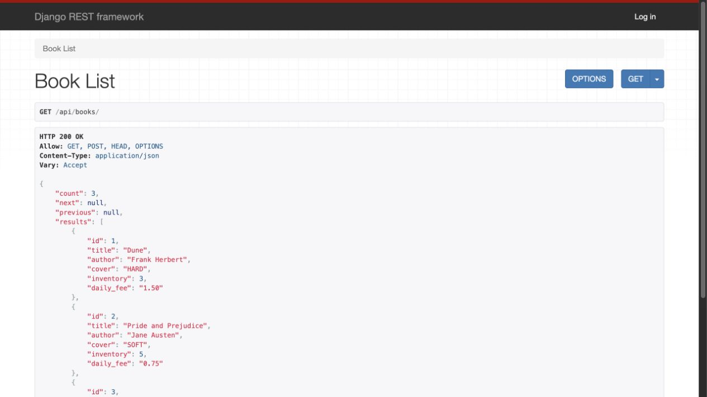
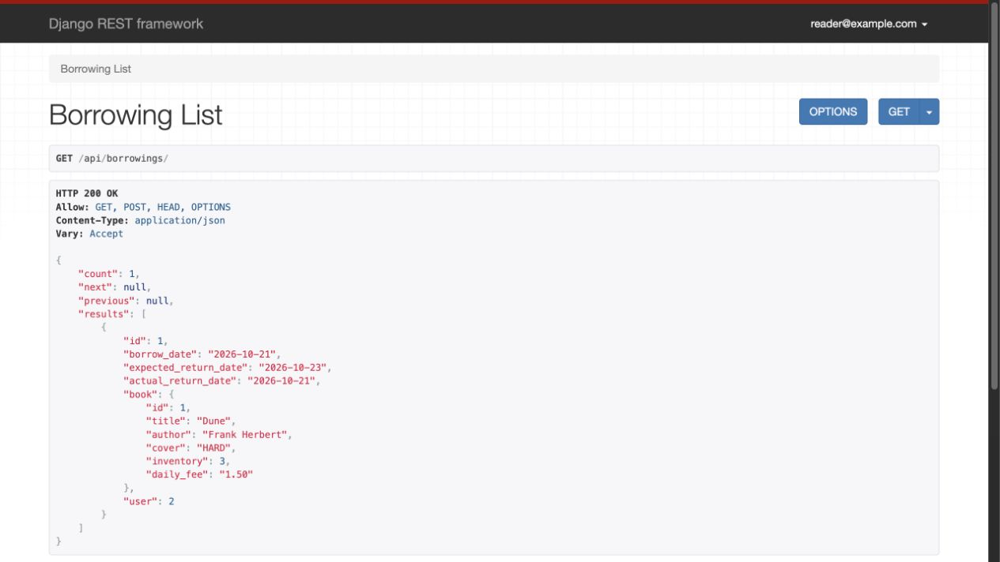

# Library Service API

Django REST Framework implementation of **Flex Library Practice tasks 1–7**. Manage books, email accounts and the full borrowing/return lifecycle through a browsable API. No frontend is required.

## Selected tasks

| Task | Implementation | Branch |
| --- | --- | --- |
| 1 | Book CRUD, HARD/SOFT cover, available inventory and USD daily fee | `codex/01-books-crud` |
| 2 | Public book reads; staff-only create/update/delete | `codex/02-book-permissions` |
| 3 | Email registration, JWT and own-profile updates | `codex/03-user-accounts` |
| 4 | Dated borrowing records, nested book details, private list/detail | `codex/04-borrowing-list-detail` |
| 5 | Atomic borrowing creation, current user ownership, stock validation | `codex/05-create-borrowing` |
| 6 | Active/returned filtering and staff customer filtering | `codex/06-borrowing-filters` |
| 7 | One-time return, actual return date and atomic inventory restoration | `codex/07-return-borrowing` |

[Review task PRs #1–#7](https://github.com/sydneyhart/library-service-api/pulls). Each task has a separate PR targeting `main`; review in numeric order because later tasks depend on earlier ones. The `develop` branch contains the complete integration. The Flex brief allows 6–8 chosen tasks, so Stripe payments, Telegram notifications and scheduled jobs are outside this seven-task selection.

## Run locally

Use Python 3.11–3.13:

```sh
git clone -b develop https://github.com/sydneyhart/library-service-api.git
cd library-service-api
python -m venv venv
source venv/bin/activate
# Windows: venv\Scripts\activate
pip install -r requirements-dev.txt
cp .env.sample .env
# Edit SECRET_KEY to a long random value.
python manage.py migrate
python manage.py createsuperuser
python manage.py seed_demo  # optional sample catalogue
python manage.py runserver
```

Open [Books](http://127.0.0.1:8000/api/books/), [Borrowings](http://127.0.0.1:8000/api/borrowings/), [Swagger](http://127.0.0.1:8000/api/docs/), or [Django admin](http://127.0.0.1:8000/admin/).

For disposable local demo accounts, use `python manage.py seed_demo --with-users`. It creates `admin@example.com` (staff) and `reader@example.com` (customer), both with password `Library-demo-2026!`. These publicly documented accounts are opt-in and only for local demonstrations. Existing accounts/passwords and live book stock are not reset when seeding again.

SQLite is the default development database. For real concurrent use, use PostgreSQL: set `DATABASE_HOST`, `DATABASE_PORT`, `DATABASE_NAME`, `DATABASE_USER`, and `DATABASE_PASSWORD` in `.env`, then migrate. PostgreSQL row locks protect the inventory under competing requests. SQLite does not provide those row locks and is intended for single-user local development here.

`SECRET_KEY` is required. `DEBUG=1` is for local development; `.env` is ignored by Git. `ALLOWED_HOSTS` is a comma-separated list of hostnames. This repository provides application code and PostgreSQL CI, rather than a public deployment.

## Authentication

Register:

```sh
curl -X POST http://127.0.0.1:8000/api/users/ \
  -H 'Content-Type: application/json' \
  -d '{"email":"ari@example.com","password":"A-long-unique-password-2026!","first_name":"Ari","last_name":"Lane"}'
```

Response: HTTP 201 with `id`, normalized email, names and `is_staff=false`. Passwords are hashed and never returned. Registration/profile edits cannot grant staff or superuser status. Email matching is case-insensitive.

Obtain tokens:

```sh
curl -X POST http://127.0.0.1:8000/api/users/token/ \
  -H 'Content-Type: application/json' \
  -d '{"email":"ari@example.com","password":"A-long-unique-password-2026!"}'
```

Response: `{"access":"<access token>","refresh":"<refresh token>"}`.

**Use the assignment's custom header: `Authorize: Bearer <access token>`.** The standard `Authorization` header is not configured for JWT in this project. Swagger's Authorize dialog expects the complete `Bearer <access token>` value for the `Authorize` header. This follows [SimpleJWT's configurable header setting](https://django-rest-framework-simplejwt.readthedocs.io/en/stable/settings.html#auth-header-name).

Access tokens last 15 minutes. `POST /api/users/token/refresh/` accepts `{"refresh":"<refresh token>"}` and returns a new access token; keep the existing refresh token, which lasts one day. For the interactive HTML API, sign in with email/password at `/api-auth/login/`; session authentication provides browser forms with CSRF protection.

## Endpoints and permissions

All endpoints below are under `/api/` and use trailing slashes.

| Endpoint | Methods | Access / behavior |
| --- | --- | --- |
| `books/` | GET, POST | Public list; staff creates books |
| `books/{id}/` | GET, PUT, PATCH, DELETE | Public detail; staff edits/deletes |
| `users/` | POST | Public registration |
| `users/token/` | POST | Public email/password login |
| `users/token/refresh/` | POST | Refresh JWT access |
| `users/me/` | GET, PUT, PATCH | Own profile only |
| `borrowings/` | GET, POST | Authenticated list/create |
| `borrowings/{id}/` | GET | Owner or staff |
| `borrowings/{id}/return/` | POST | Owner or staff; returns one copy once |
| `docs/`, `schema/` | GET | Public Swagger and OpenAPI schema |

Lists use pagination: `count`, `next`, `previous`, `results`, with 20 results per page. Staff can see all borrowings. Customers always see only their own records, including when they supply another user's ID.

### Book payload

```json
{"title":"Dune","author":"Frank Herbert","cover":"HARD","inventory":3,"daily_fee":"1.50"}
```

`cover` is `HARD` or `SOFT`; inventory is the number **currently available**, so zero is valid. Daily fee must be positive, with at most two decimal places. Books referenced by borrowing history cannot be deleted (HTTP 400).

### Borrow a book

```sh
curl -X POST http://127.0.0.1:8000/api/borrowings/ \
  -H 'Authorize: Bearer <access token>' \
  -H 'Content-Type: application/json' \
  -d '{"book":1,"expected_return_date":"2026-12-01"}'
```

Choose an expected return date on or after today. The API assigns the current user and UTC borrow date; clients cannot override ownership, borrow date or actual return date. A successful HTTP 201 response includes:

```json
{"id":1,"borrow_date":"2026-11-28","expected_return_date":"2026-12-01","actual_return_date":null,"book":{"id":1,"title":"Dune","author":"Frank Herbert","cover":"HARD","inventory":2,"daily_fee":"1.50"},"user":2}
```

Out-of-stock books, invalid book IDs or past expected return dates return HTTP 400. Creation and inventory decrement succeed together or both roll back. PostgreSQL serializes competing requests for the last available copy.

### Filters

- `/api/borrowings/?is_active=true`: not returned.
- `/api/borrowings/?is_active=false`: returned.
- `/api/borrowings/?user_id=2&is_active=true`: staff filter for a customer.
- Boolean filters accept `true`, `false`, `1`, `0`; invalid values return HTTP 400.
- A customer's `user_id` parameter is ignored; it never expands their access.

### Return a book

```sh
curl -X POST http://127.0.0.1:8000/api/borrowings/1/return/ \
  -H 'Authorize: Bearer <access token>'
```

No body is required. HTTP 200 returns the borrowing with today's `actual_return_date` and updated inventory. A second return is rejected with HTTP 400 and does not change inventory. Another customer's record returns HTTP 404; unauthenticated access returns HTTP 401. Arbitrary borrowing updates/deletes are unavailable, preventing stock changes outside the lifecycle.

## Validation and coverage

```sh
coverage run manage.py test --settings=config.test_settings
coverage report
python manage.py makemigrations --check --dry-run
python manage.py spectacular --file /tmp/library-schema.yml --validate --fail-on-warn
ruff check .
ruff format --check .
pip check
```

The suite has 36 tests. SQLite passes 34 and skips two PostgreSQL-only concurrency tests. PostgreSQL runs all 36, including five simultaneous borrowers competing for the final copy and five competing returns of the same borrowing. Tests cover permissions, dates, database constraints, rollback, ownership, registration/profile security and the custom JWT header.

Coverage is enforced at **60% minimum** for custom application code, excluding tests, migrations and framework registration files. Current local coverage is **93%**. GitHub Actions also validates Python 3.11/3.13, PostgreSQL, schema generation, migrations, style, dependencies and an HTTP borrow/return inventory smoke test.

## Project board and review workflow

[Task plan](docs/task-plan.md) records the dependency order. [Trello-ready CSV](docs/trello-tasks.csv) contains the seven cards for a board with **To Do (Backlog)**, **In Progress (Doing)**, **On Review**, and **Done (Completed)** columns. A prepared CSV is not a live Trello board; board access is handled separately.

The `main` branch starts with the project foundation. Each task PR records its review/merge state on GitHub; use those recorded states when submitting closed PR links. The full-time requirement for two teammate approvals is not part of this individual Flex selection.

## Browsable API captures




[Borrowing detail](docs/screenshots/borrowing-detail.jpg) · [Own profile](docs/screenshots/profile.jpg)
